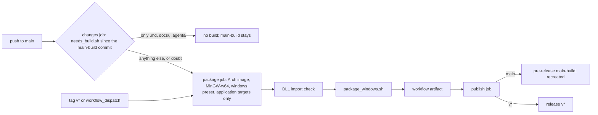

# Windows release

`package_windows.sh` turns a Windows cross build into `Kinetra-Lab-windows-x64.zip`, which runs without installing anything; `needs_build.sh` tells the workflow when a merge cannot change that zip, and tells [CI](../../.github/workflows/ci.yml) when a pull request cannot change the build. The [release workflow](../../.github/workflows/release.yml) builds and publishes it as a GitHub Release asset, so someone who wants to try Kinetra-Lab needs no compiler, dependencies or Git.

## Table of contents

- [Download](#download)
- [What the zip contains](#what-the-zip-contains)
- [How it is published](#how-it-is-published)
- [Build the zip locally](#build-the-zip-locally)
- [Changing this tool](#changing-this-tool)

[Windows](../../docs/windows.md) · [Project overview](../../README.md) · [Documentation index](../../docs/README.md)

## Download

- Latest `main`: [Kinetra-Lab-windows-x64.zip](https://github.com/SMB-M87/Kinetra-Lab/releases/download/main-build/Kinetra-Lab-windows-x64.zip) from the [`main-build` pre-release](https://github.com/SMB-M87/Kinetra-Lab/releases/tag/main-build), refreshed on every merge that can change the zip.
- Fixed versions: the [releases](https://github.com/SMB-M87/Kinetra-Lab/releases) tagged `v*`.

Unzip, then start `kinetra.exe`. Windows 10 or later with an OpenGL 3.3 driver is enough. The executables are not signed, so SmartScreen may ask for confirmation (*More info*, *Run anyway*).

## What the zip contains

```text
Kinetra-Lab-windows-x64/
├── kinetra.exe            # bundled launcher
├── kinetra_demo.exe       # standalone applications
├── kinetra_dotio.exe
├── kinetra_i4sim.exe
├── SDL2.dll
├── i4sim-blueprints/      # read next to the executable by i4sim
├── licenses/              # Kinetra-Lab, Kinetra, SDL2, nlohmann_json
└── README.txt             # how to start, and the commit it was built from
```

The executables link the GCC runtime statically ([toolchain](../../docs/windows.md#how-it-works)), so they import only Windows system libraries and `SDL2.dll`. The workflow checks that list before packaging.

## How it is published



*Takeaway:* the zip is built from exactly the merged commit, unless nothing that goes into it changed since the last build; tests are not repeated, because the pull request's CI already ran them, natively on Windows included.

- The build uses the pinned Arch image and snapshot of [ci.yml](../../.github/workflows/ci.yml); bump them together. As there, when the Arch Linux Archive does not answer, the image's own mirrors serve the current packages and the run warns *Toolchain not pinned*; the DLL import check still guards the zip.
- Only the four application targets are built. The doctest discovery of the test executables would need to run `.exe` files on Linux.
- A push to `main` builds only when the zip can differ from the one `main-build` holds. The `changes` job runs `needs_build.sh` from the commit of the `main-build` tag to the pushed commit: it skips the build only when every changed Lab path is Markdown, `docs/` or `.agents/`, apart from `README.md`, `docs/media/` and `labs/i4sim/blueprints/`, and every path in the Kinetra range of a moved pointer is Markdown, `docs/`, `.agents/`, `.github/` or `tools/`. [ci.yml](../../.github/workflows/ci.yml)'s `changes` job runs the base branch's copy of the same script on every pull request, so a pull request whose build is skipped there leaves the zip unchanged here. The three Lab paths build because a test reads the first two and the zip holds the third; the zip cannot differ when only `README.md` or `docs/media/` changed, so such a push rebuilds it and moves `main-build` for nothing, the cost of one decision for both workflows. A rename counts with its old path, so a source moved into `docs/` builds. Any doubt builds: no tag, a commit that is not an ancestor, a failed diff, `grep` or Kinetra clone, or a failed `changes` job. The run then shows the notice *Release not rebuilt*.
- When it builds, `main-build` is deleted and created again, so its tag points at the commit the zip came from and its download URL never changes. A skipped push leaves it on that commit, whose zip is the same apart from the commit in `README.txt`.
- A tag `v*` and `workflow_dispatch` always build.
- `workflow_dispatch` on `main` refreshes `main-build` by hand; on another branch it only builds the artifact.

## Build the zip locally

To see what the workflow would decide for a push, from a Lab checkout with full history (`true` builds, the reason goes to stderr):

```sh
git fetch --tags origin
tools/release/needs_build.sh main-build origin/main
```


With the MinGW-w64 cross compiler from the [Windows guide](../../docs/windows.md#quick-start-from-wsl):

```sh
cmake --preset windows
cmake --build --preset windows --target kinetra kinetra_demo kinetra_dotio kinetra_i4sim
tools/release/package_windows.sh build-windows dist/Kinetra-Lab-windows-x64.zip
```

## Changing this tool

- A new application executable goes into `executables` in `package_windows.sh`, into the workflow's build targets, and into the tree above.
- A new runtime file that the applications read must be copied next to the executables, like `i4sim-blueprints/`.
- `README-windows.txt` becomes `README.txt` in the zip, with `@COMMIT@` replaced and Windows line endings.
- A new input of the zip, the build or a test under a path the filter in `needs_build.sh` lets through (Markdown, `docs/`, `.agents/`, and in Kinetra `.github/` or `tools/`) must be listed in its `read_anyway`, as `README.md`, `docs/media/` and `labs/i4sim/blueprints/` are, or a change to it would neither be built and tested in CI nor released.
